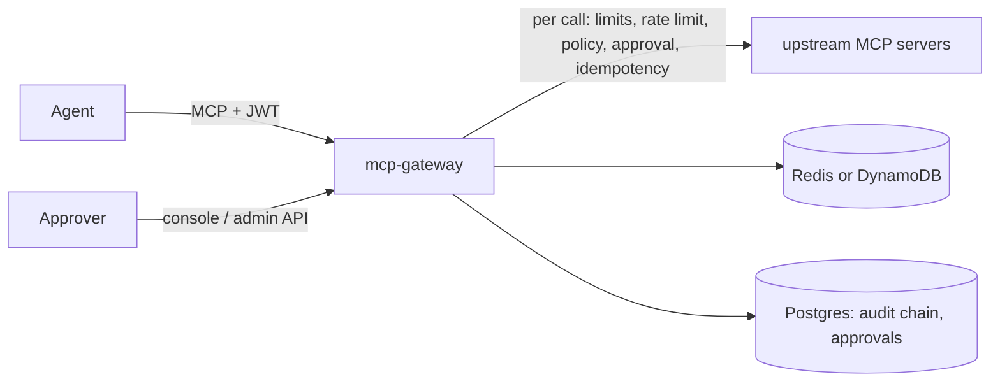

# mcp-gateway

A Go gateway between LLM agents and the MCP servers that front internal systems. Agents get one Streamable
HTTP endpoint; every tool call is authenticated per tenant and agent, filtered and decided by OPA policy,
held for a human when policy says so, made idempotent if it writes, marked as untrusted output with an
injection score, redacted and recorded in a SHA-256 hash-chained audit log. The gateway calls no model.

All data is synthetic (seed 20260). MIT licensed.

## Why

Giving an agent tools means giving it the authority of whoever runs those tools. A refund endpoint does not
know an LLM is calling, an injected CRM note can steer the next call, and a timeout during a write invites a
duplicate retry. mcp-gateway puts the controls in one place, in front of every upstream, without changing
the upstreams:

- **Least privilege per tenant and agent:** agents only see the tools policy allows them (`tools/list` is
  filtered per principal), and every call is decided again.
- **Humans in the loop for risky writes:** a refund above the automatic limit is held; an approver decides
  in the console or the admin API, and only the identical call can use the approval, once.
- **Exactly-once writes:** writes need an idempotency key; retries replay the stored result, and the example
  upstreams dedup on the key as a second layer.
- **Evidence:** every outcome, rejections included, lands in an append-only, hash-chained audit log that
  `mcp-gateway audit verify` checks.

## Results

Measured on a 4-vCPU cloud container (Intel Xeon @ 2.10 GHz) on 2026-10-17. Each number links the command
and the report that produced it.

| What | Result | Target | Source |
|---|---|---|---|
| Gateway overhead per call, p95 | 0.398 ms | < 5 ms (NFR-1) | `make bench`, `docs/perf/bench.txt` |
| Console audit page over 100,000 rows, p95 | 11.79 ms | < 300 ms (NFR-8) | `make bench`, `docs/perf/bench.txt` |
| Throughput, 80% reads, 0 errors | 630.0 calls/s, **NFR-2 not met** | ≥ 2,000 on 8 vCPUs (CI: ≥ 500) | `make loadtest-profile`, `docs/perf/loadtest.json` |
| Gateway memory under that load | 93.9 MB RSS (not verified at 2,000 calls/s) | < 128 MB (NFR-7) | `make loadtest-profile`, `docs/perf/loadtest.json` |
| Time to ready | 22.2 ms | < 2 s (NFR-5) | `go test -tags=integration -run TestStartupUnder2s -v ./internal/server`, `docs/perf/startup.txt` |
| Gateway image | 17.6 MB compressed (57.6 MB unpacked) | < 40 MB (NFR-10) | `make image-size` |
| Policy decision accuracy (test split) | 1.0 | = 1.0 | `make eval`, `evals/REPORT.md` |
| Injection recall / false-positive rate (test split) | 0.80 / 0.0 | ≥ 0.80 / ≤ 0.05 | `make eval`, `evals/REPORT.md` |
| Redaction recall / precision (test split) | 1.0 / 1.0 | ≥ 0.98 / ≥ 0.95 | `make eval`, `evals/REPORT.md` |
| Chaos run with timeouts and retries: duplicate writes, audited ratio | 0 and 1.0 | 0 and 1.0 | `make chaos`, `evals/reports/chaos.v1.json` |

Read the caveats before quoting these:

- Throughput is CPU-bound on this machine, and the per-call CPU suggests that 8 vCPUs alone would not
  reach 2,000 calls/s (`docs/KNOWN_LIMITATIONS.md`, from `docs/perf/cpu.txt`).
- The eval data is synthetic and built from templates. Injection recall measures new fills of known
  phrasings, not new attacks (`docs/evaluation.md`, `evals/REPORT.md`).
- Injection scoring is defence in depth. The controls that hold regardless of the score are untrusted
  marking, policy and approvals.

## Quick start

Needs Docker with Compose. Ports 8200-8299 on 127.0.0.1.

```sh
make up        # build and start Postgres, Redis, the issuer, three upstreams, the approval sink and the gateway
make seed      # synthetic customers, accounts and orders (seed 20260)
make demo      # the scripted scenario below, PASS or FAIL per step
open http://localhost:8200   # console: sign in as a persona (development issuer)
```

Or, without make: `docker compose up -d --wait && docker compose --profile tools run --rm seed`.

| Port | Service |
|---|---|
| 8210 | MCP endpoint (`POST /mcp`, bearer JWT) |
| 8200 | admin API and console |
| 8211 | Prometheus metrics |
| 8212 | development token issuer (JWKS) |
| 8213-8215 | example upstreams: ledger, crm, orders |

Mint a token and talk to the gateway:

```sh
export MCPGW_DEV_TOKEN=$(make -s dev-token SCOPES=crm:read,orders:read,orders:write)
go run ./cmd/demo-agent --list
go run ./cmd/demo-agent --call orders.refund_order --args '{"order_id":"O-00002","amount_cents":5000,"reason":"damaged"}' --key my-key-0001
```

## The demo

`make demo` (`scripts/demo.sh`, `cmd/demo-agent`, no model) drives the running stack through seven steps and
prints PASS or FAIL for each:

1. only the allowed tools are listed;
2. a USD 50 refund executes;
3. a USD 500 refund is held, approved through the admin API, and the retry executes once;
4. the orders upstream is killed mid-call, and the same-key retry leaves one refund row;
5. an injected CRM note comes back marked untrusted and flagged;
6. `audit verify` passes;
7. `scripts/tamper_audit.sh` edits one audit row as the database superuser, and verify fails at exactly
   that seq (the script then restores the row).

## How it works



Each `tools/call` goes through the stages in order (`internal/pipeline/pipeline.go`):

1. audit slot;
2. argument limits and input schema;
3. tenant and agent rate limits and budget;
4. idempotency key;
5. OPA decision;
6. approval;
7. idempotency acquire;
8. upstream call;
9. result size;
10. untrusted marking and injection score;
11. audit record.

Every failure path fails closed with a JSON-RPC error code. The full picture is in `docs/architecture.md`,
the reasoning in `docs/adr/` (ADRs 0001-0008), and fifteen design questions are answered with code
references in `docs/design-faq.md`.

- **Policy:** Rego in `policies/`, embedded OPA, hot reload; `make policy-test`, `POST /admin/policy/evaluate`
  and the console's policy tester.
- **Adding an upstream** takes one entry in `config/upstreams.yaml` and one line of policy data
  (`tests/integration/add_upstream_test.go`, `.claude/skills/add-upstream-server/SKILL.md`).
- **Operations:** Prometheus metrics, alerts with promtool tests, a Grafana dashboard
  (`make observability`), OpenTelemetry traces, and a Helm chart with Redis and DynamoDB values
  (`deploy/helm/mcp-gateway`, `docs/runbook.md`).

## Evaluation

`make eval` runs the offline suites (policy, injection, redaction, policy latency) on generated, labelled
datasets, writes `evals/REPORT.md` and fails on any threshold miss or regression beyond 1.0 pp against the
baseline; `make chaos` runs the duplicate-write and audit-completeness suite against the stack. Method,
caveats and what the numbers do not show: `docs/evaluation.md`.

## Security

Threat model (STRIDE per component), the OWASP Top 10 for LLM applications mapped to controls, scan results
and accepted findings are in `docs/security.md`; run the scans with `make security`. Report vulnerabilities as
described in `SECURITY.md`. The console's persona sign-in and the token issuer are for development only.

## Repository layout

| Path | What |
|---|---|
| `cmd/mcp-gateway` | `serve`, `dev-issuer`, `dev-token`, `migrate`, `audit verify`, `policy test`/`fmt`, `healthcheck` |
| `cmd/upstream-{ledger,crm,orders}`, `pkg/mcpserver` | example upstreams on Postgres and the public helpers they use |
| `cmd/{demo-agent,loadgen,datagen,evalgen}` | demo client, load and chaos generator, synthetic data, eval runner |
| `internal/` | the gateway: `authn`, `catalog`, `proxy`, `pipeline`, `policy`, `idempotency`, `approvals`, `audit`, `redact`, `injection`, `ratelimit`, `admin`, `console`, `telemetry`, `server` |
| `policies/`, `config/`, `migrations/`, `api/openapi.yaml` | Rego, YAML configuration, goose SQL, admin API contract |
| `evals/`, `e2e/`, `tests/` | datasets and reports; Playwright and axe; integration, contract, Helm, Docker and harness tests |
| `deploy/` | Helm chart, Prometheus alerts, Grafana dashboard, OpenTelemetry collector, WireMock |

## Development

`make bootstrap` installs pinned tools into `./bin`. `make check-fast` runs format, vet, golangci-lint and
the unit tests. `make test` adds the integration, contract, policy and hook tests, and `make test-docker`
runs the full suite inside containers. `make verify` is the single gate. Setup details are in
`docs/DEVELOPMENT.md`; the workflow and conventions are in `CONTRIBUTING.md`.

The project uses an AI-assisted workflow (Claude Code configuration in [`CLAUDE.md`](CLAUDE.md) and
[`.claude/`](.claude/)), with tests and evals gating every change.

## Limitations

The most important ones:

- NFR-2 throughput is not met on the 4-vCPU development machine.
- Console sign-in is development only.
- The eval data is synthetic.
- Audit events still queued in memory are lost on a hard crash.

The full list, with what each would take, is in `docs/KNOWN_LIMITATIONS.md`.
