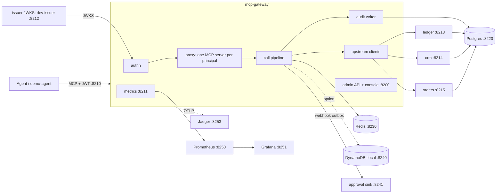

# Architecture

mcp-gateway sits between LLM agents and upstream MCP servers. Agents see one Streamable HTTP endpoint;
every `tools/call` passes authentication, limits, rate limits, an OPA policy decision, an optional human
approval, mandatory idempotency for writes, the upstream call, untrusted-output marking with injection
scoring, redaction and a hash-chained audit record. The gateway calls no model. Design decisions are in `docs/DECISIONS.md` and
`docs/adr/`.

## Components



| Package | Responsibility |
|---|---|
| `internal/authn` | RS256 JWT verification (`kid` required, issuer, audience, lifetime), JWKS cache with single-flight refresh and a stale limit |
| `internal/catalog` | one MCP client per upstream, `<server>.<tool>` namespacing, periodic refresh, `tools/list_changed`, circuit breaker per upstream |
| `internal/proxy` | the Streamable HTTP handler; one `*mcp.Server` per principal (tenant, agent, scopes) holding only the tools policy lets it see, cached and rebuilt on policy reload or catalog change |
| `internal/pipeline` | the `tools/call` stages below |
| `internal/policy` | embedded OPA: `policies/` compiled into the prepared query `data.mcpgw.authz.decision`, atomic hot reload ([ADR 0002](adr/0002-embedded-opa-vs-sidecar.md)) |
| `internal/idempotency` | Redis, DynamoDB and memory stores behind one interface ([ADR 0003](adr/0003-redis-and-dynamodb-idempotency-one-interface.md)) |
| `internal/approvals` | approval records, single use, bound to tenant, agent, tool, arguments hash and key; signed webhook outbox |
| `internal/audit` | bounded writer, seq allocation, hash chain under a Postgres advisory lock, verification ([ADR 0004](adr/0004-hash-chained-postgres-audit-vs-append-only-s3.md)) |
| `internal/redact`, `internal/injection` | PII redaction before storage and logs; heuristic injection scoring ([ADR 0005](adr/0005-heuristic-injection-scoring-vs-ml-classifier.md)) |
| `internal/ratelimit` | per-tenant and per-agent token buckets and daily budgets in Redis, with a per-process fallback for reads |
| `internal/admin`, `internal/console` | admin REST API (`api/openapi.yaml`) and the server-rendered console ([ADR 0007](adr/0007-server-rendered-console-vs-spa.md)) |
| `internal/telemetry` | OpenTelemetry spans, Prometheus metrics, redacting slog logger, step records |
| `internal/server` | assembles the App: listeners, background workers, readiness |
| `pkg/mcpserver` | public helpers for upstreams: read and write tools, tenant context, upstream-side dedup ([ADR 0008](adr/0008-upstream-side-dedup-second-idempotency-layer.md)) |

## The call pipeline

`internal/pipeline/pipeline.go` runs these stages for every `tools/call`. Each outcome, rejections included,
produces exactly one audit event.

1. **Audit reservation.** A slot in the bounded audit buffer and a seq are reserved first; if none is
   available within the enqueue timeout the call fails with `-32048` and nothing else happens.
2. **Arguments.** Parsed as I-JSON objects; nesting depth ≤ 32 and the tool's input schema are checked
   (`internal/pipeline/limits.go`).
3. **Rate limit and budget.** Tenant and agent token buckets and the tenant's daily budget
   (`-32042`, `-32043`).
4. **Idempotency key.** Writes (`readOnlyHint` false) need `_meta.idempotency_key` or the
   `Idempotency-Key` header (`-32041`).
5. **Policy.** OPA decides allow, require approval or deny with reasons (`-32044`).
6. **Approval.** A hold creates an approval and returns `approval_required`; a retry with
   `_meta.approval_id` must match tenant, agent, tool, arguments hash and key, and consumes it.
7. **Idempotency acquire.** Same key and hash replays the stored result; a different hash is
   `-32040`; a concurrent holder is `-32047`.
8. **Upstream call.** Forwarded with `_meta.idempotency_key` and `_meta.mcpgw`; timeout and breaker
   (`-32046`). The gateway never retries a write.
9. **Result.** Results over 4 MiB are refused; the key is completed (or released on a tool error).
10. **Output marking.** Text is prefixed `<<untrusted tool output>>`, `structuredContent.untrusted`
    is set, and the injection score and signals go into `_meta.mcpgw.injection`.
11. **Audit commit and step record.** The redacted event is queued for the writer; metrics and the
    step record are emitted.

```mermaid
sequenceDiagram
  participant Ag as Agent
  participant Gw as Gateway
  participant Rd as Redis
  participant Up as orders
  Ag->>Gw: tools/call orders.refund_order, key K
  Gw->>Gw: audit slot, limits, rate limit, policy allow
  Gw->>Rd: acquire K (in progress, NX, lock TTL)
  Gw->>Up: refund_order, _meta.idempotency_key K
  alt ok
    Up-->>Gw: result
    Gw->>Rd: complete K (args hash, result)
    Gw-->>Ag: marked result; audit status ok
  else timeout
    Gw->>Rd: release K
    Gw-->>Ag: -32046; audit status error
    Ag->>Gw: retry with key K
    Gw->>Up: refund_order key K
    Up->>Up: unique (tenant, key): stored result
    Up-->>Gw: same result, one refund row
  end
```

```mermaid
sequenceDiagram
  participant Ag as Agent
  participant Gw as Gateway
  participant Pg as Postgres
  participant Ap as Approver
  Ag->>Gw: refund_order above the auto limit, key K
  Gw->>Pg: policy require_approval; insert approval and outbox row
  Gw-->>Ag: approval_required, approval_id A
  Gw->>Gw: outbox worker posts the signed webhook
  Ap->>Gw: POST /admin/approvals/A:approve (or the console)
  Ag->>Gw: retry with _meta.approval_id A, key K
  Gw->>Pg: lock A; check approved, tenant, agent, tool, args hash, expiry; mark consumed
  Gw-->>Ag: result
```

## Data

Postgres 16 with goose migrations (`migrations/`). The gateway role `mcpgw_app` may only INSERT and
SELECT on `audit_events`, and a trigger rejects UPDATE, DELETE and TRUNCATE. `audit_events` holds the
`mcpgw.audit.v1` fields plus `chain_pos`; `hash = sha256(prev_hash + canonical_json(event))`. Appends from
every replica take one transaction advisory lock, so they extend a single, totally ordered chain;
`mcp-gateway audit verify` re-hashes it and names the first bad seq. `approvals`, `webhook_outbox` and
`injection_findings` back the approval flow and the console. The example upstreams own the `ledger`,
`crm` and `orders` schemas, with a unique `(tenant, idempotency_key)` on every write table.

Redis keys: `mcpgw:idem:{tenant}:{key}`, `mcpgw:rl:…` and `mcpgw:budget:{tenant}:{yyyymmdd}`. With
`MCPGW_IDEMPOTENCY_STORE=dynamodb`, idempotency records live in a DynamoDB table with conditional writes
and a TTL attribute.

## Failure behaviour

The gateway fails closed. Background workers (audit writer, outbox, catalog refresh, policy watcher,
retention) share one errgroup that is cancelled on SIGTERM; the audit buffer is drained within
`MCPGW_SHUTDOWN_TIMEOUT`.

| Dependency down | Behaviour |
|---|---|
| Policy bundle | no bundle: deny all and `/readyz` 503; a failed reload keeps the last good bundle (`mcpgw_policy_stale`) |
| Redis or DynamoDB | writes `-32049`; reads fall back to a per-process token bucket |
| Postgres | calls fail `-32048` once a seq or audit slot cannot be had within the enqueue timeout; `/readyz` 503 until the first block of seqs is allocated |
| JWKS issuer | cached keys until `MCPGW_JWKS_STALE_LIMIT`, then 401 |
| Upstream | `-32046`, circuit breaker, audit `status=error` |
| Approval sink | outbox retries with backoff |

## Deployment

- **Local:** `compose.yaml` runs Postgres, Redis, the approval sink (WireMock), the migrate job, the dev
  issuer, the three example upstreams and the gateway, all with healthchecks; profiles `tools` (seed),
  `dynamodb` and `observability` (Prometheus, Grafana, Jaeger). `compose.test.yaml` adds the containerised
  test runners for `make test-docker`.
- **Image:** one multi-stage `Dockerfile`; the gateway runs on `gcr.io/distroless/static-debian12:nonroot`.
- **Kubernetes:** the Helm chart in `deploy/helm/mcp-gateway` (Deployment, Service, ConfigMap, migrate Job,
  HPA, PodDisruptionBudget, NetworkPolicy, `values.schema.json`, Redis and DynamoDB values); operations in
  `docs/runbook.md`.

## Observability

Spans per stage (`mcp.request`, `mcpgw.authn`, `mcpgw.policy.eval`, `mcpgw.idempotency`,
`mcpgw.upstream.call` with W3C context forwarded, `mcpgw.audit.enqueue`) plus pgx and go-redis spans;
slog JSON logs through the redacting handler; Prometheus metrics on 8211 (`mcpgw_tool_calls_total`,
`mcpgw_overhead_seconds`, `mcpgw_policy_decisions_total`, `mcpgw_idempotency_replays_total`,
`mcpgw_approvals_pending`, `mcpgw_injection_flags_total`, `mcpgw_audit_buffer_depth`, `mcpgw_upstream_up` and
the alert helpers); alerts in `deploy/prometheus/alerts.yaml` with promtool tests; a Grafana dashboard in
`deploy/grafana/`.
